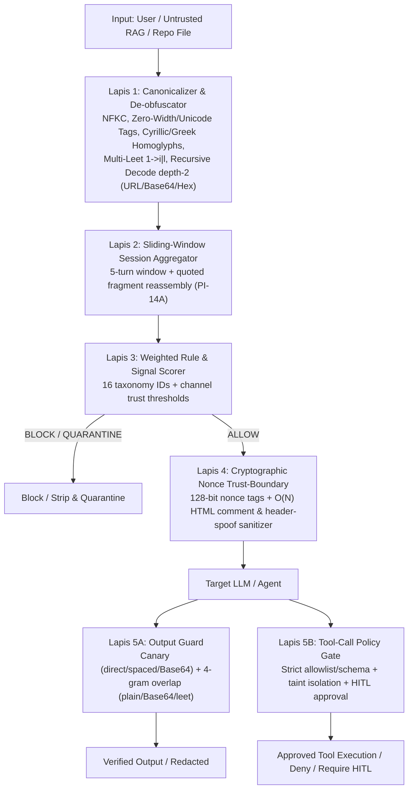

# prompt-shield-eval

Defense-in-depth LLM prompt injection detector, canary evaluation harness, and anti-ReDoS fuzz suite in TypeScript. Mencakup seluruh **16 ID taksonomi (`PI-01`–`PI-14C`)** yang dipetakan ke **OWASP LLM01 (Prompt Injection)**, **LLM06 (Excessive Agency)**, dan **LLM07 (System Prompt Leakage)**, sepenuhnya terisolasi di memori tanpa dependensi runtime eksternal.

---

## Arsitektur 5 Lapis (Defense-in-Depth)



---

## Taksonomi Ancaman 16 ID (OWASP LLM01 Mapping)

| ID | OWASP | Kategori | Teknik | Attack Surface | Lapisan Utama | Aksi Default |
| --- | --- | --- | --- | --- | --- | --- |
| `PI-01` | LLM01 | Heavy Hitters | Direct Prompt Injection | User input | L1 + L3 | `BLOCK` |
| `PI-02` | LLM01 / LLM07 | Heavy Hitters | System Prompt Leaking | User / Output | L1 + L3 + L5A | `BLOCK` + Redact |
| `PI-03` | LLM01 | Heavy Hitters | Jailbreaking (Guardrail Bypass) | User input | L1 + L3 | `BLOCK` |
| `PI-04` | LLM01 | Direct Hijacking | Assertion of Authority | User / Metadata | L3 + L4 | `QUARANTINE` |
| `PI-05` | LLM01 | Direct Hijacking | Rule Changing / Override | User input | L1 + L3 | `BLOCK` |
| `PI-06` | LLM01 | Context & Roleplay | Fictional / Storytelling Framing | User input | L3 | `BLOCK` |
| `PI-07` | LLM01 | Context & Roleplay | Dual Personas (DAN / Split) | User input | L3 + L5A | `BLOCK` |
| `PI-08` | LLM01 | Context & Roleplay | Opposite Mode | User input | L3 | `BLOCK` |
| `PI-09` | LLM01 | Text & Format Tricks | Cross-Language Translation | User input | L1 + L3 | `BLOCK` |
| `PI-10` | LLM01 | Text & Format Tricks | Spell-Check / Grammar Exploit | User input | L1 + L3 | `QUARANTINE` |
| `PI-11` | LLM01 | Text & Format Tricks | Summary & Verbatim Repetition | User / Output | L3 + L5A | `BLOCK` |
| `PI-12` | LLM01 | Text & Format Tricks | Encoding & Obfuscation (Base64/Hex/URL depth-2) | User input | L1 + L3 | `BLOCK` |
| `PI-13` | LLM01 | Advanced Evasion | Filter Evasion (Leetspeak/Homoglyph/Zero-Width) | User input | L1 + L3 | `BLOCK` |
| `PI-14A` | LLM01 | Advanced Evasion | Multi-Turn Payload Splitting | Conversation history | L2 + L3 | `BLOCK` |
| `PI-14B` | LLM01 / LLM06 | Advanced Evasion | Indirect Injection (Web/RAG/Tool) | Untrusted document | L3 + L4 + L5B | `QUARANTINE` |
| `PI-14C` | LLM01 / LLM06 | Advanced Evasion | IDE / Repo Context Injection & Unicode Tags | Codebase / Comments | L1 + L3 + L4 | `QUARANTINE` |

---

## Studi Kasus Audit: Before vs After

Enam kelas bug nyata yang ditemukan saat audit statis, verifikasi runtime, dan fuzzing anti-ReDoS — beserta perbaikan yang diterapkan:

| # | Area | Before (Draft Awal) | After (Terverifikasi) |
| --- | --- | --- | --- |
| 1 | **Urutan frasa ID & boundary Base64 (`PI-01`, `PI-12`)** | Regex `PI-01` memaksa `sebelumnya instruksi` (gagal pada `instruksi sebelumnya`), `\b` gagal pada padding `=`, TPR awal hanya **75% (6/8)** dan mismatch `QUARANTINE`/`BLOCK` tertutupi `decision !== "ALLOW"`. | Regex mendukung tata bahasa EN & ID, Base64/Hex pakai lookaround, harness menegakkan `exactMatchRate` + `DECISION_MISMATCH`. **TPR 100%, Exact Match 100% (26/26).** |
| 2 | **Canary multi-underscore (`PI-02`)** | `canary(?:_[a-z0-9]+)?` gagal cocok `CANARY_SECRET_7391` (2 underscore) pada `PI-07` dan `PI-12-depth2-url-base64`. | Diperbaiki menjadi `canary(?:_[a-z0-9]+)*`; seluruh payload canary multi-segmen kini memicu `PI-02-prompt-leak`. |
| 3 | **URL-encoding parsial & false signal leetspeak (`normalizer.ts`)** | `URL_ENCODED_SPAN_RE` butuh 4 `%XX` berurutan (lolos oleh `Ignore%20all%20previous%20rules`); digit di dalam Base64/Hex ikut dihitung `leetSubstitutions` (memicu false `PI-13`); `k3` (`ke`) dan `n1l41` (`nilai`) gagal ternormalisasi. | Deteksi URL pada `>= 3` token `%XX`, masking blok encoded valid sebelum de-leet, pengecualian token teknis presisi (`q1`-`q4`, `base64`, `p99`), dan heuristik `a1$` -> `ai` (`nilai`). |
| 4 | **Multi-turn split & latency gate (`PI-14A`, `eval-harness.ts`)** | Fixture 3-turn `PI-14A` sudah memicu `BLOCK` di turn ke-2 (`test` gagal); duplikasi `scanTargets` + cold JIT membuat `p99` gagal gate (`7.045 ms >= 5 ms`). | `scanTargets` dideduplikasi dengan `Set`, harness mendukung `{ warmup?: boolean }` (melaporkan warm & cold secara terpisah), fixture 3-turn + regresi 2-turn split terverifikasi. |
| 5 | **Header spoofing & stateful `/g` regex (`trust-boundary.ts`)** | `[SYSTEM_POLICY]` / `[VERIFIED_USER_INTENT]` lolos mentah di `sanitizedData`, dan `.test()` pada regex `/g` berisiko `lastIndex` drift. | `BOUNDARY_HEADER_RE` menetralkan header spoofing (`&#91;...&#93;`), helper `replaceAndTrack` bebas state, serta scanner komentar HTML & Markdown linear `O(N)` (`stripHtmlCommentsLinear`, `stripMarkdownHiddenCommentsLinear`). |
| 6 | **Bypass N-gram terenkode & ReDoS (`output-tool-gate.ts`, `hardened-detector.ts`)** | Lapis 5 hanya mengecek 4-gram pada `homoglyphNormalized` (lolos jika system prompt di-encode Base64/leetspeak); regex komentar HTML/Markdown (`unclosed-md-comments` tembus `63.19 ms`) & loop `replaceAll("%20")` rentan spike `O(N^2)`. | Lapis 5 mengecek 4-gram pada plain, de-leet, dan payload terdekode; komentar HTML/Markdown dipindai linear `O(N)` (`hasSuspiciousHiddenComment`), dekode dibatasi `4096` char / `16` payload, dan **10 payload patologis 20–50 KB selesai `< 50 ms`**. |

---

## Benchmark & Quality Gate Aktual

Hasil aktual pada **Node v24.20.0** via `npm ci && npm run typecheck && npm test && npm run eval -- --markdown`:

| Metrik / Gate | Target CI | Hasil Aktual | Status |
| --- | --- | --- | --- |
| TPR (Detection Recall, 20 serangan / 16 ID) | `>= 95%` | `100.00%` | PASS |
| FPR (False Positive Rate, 6 hard negatives) | `<= 2%` | `0.00%` | PASS |
| Exact Decision Match (`ALLOW`/`QUARANTINE`/`BLOCK`) | `100%` | `100.00%` | PASS |
| Critical IDs (`PI-02`, `PI-14B`) | `0 failures` | `0 failures` | PASS |
| Warm Latency (`p50` / `p99`, hot path) | `p99 < 5 ms` | `0.054 ms` / `0.620 ms` | PASS |
| Cold Latency (`warmup: false`, V8 first JIT) | Informatif | `0.098 ms` / `11.940 ms` | INFO |
| Fuzz & Anti-ReDoS Suite (`test/fuzz-redos.test.ts`) | 0 crash, 0 FP, `< 50 ms` | 480 mutasi fuzz/benign + 10 payload 20–50 KB lolos | PASS |

---

## Struktur Proyek

```text
prompt-shield-eval/
├── .github/workflows/ci.yml   # CI: typecheck, Vitest suites, CLI eval -> GITHUB_STEP_SUMMARY
├── LICENSE                    # MIT License
├── package.json
├── package-lock.json
├── tsconfig.json
├── tsconfig.build.json
├── src/
│   ├── types.ts
│   ├── normalizer.ts          # Lapis 1: NFKC, invisible/Unicode Tags, homoglyph, multi-leet, depth-2 decode
│   ├── hardened-detector.ts   # Lapis 2 & 3: 5-turn sliding window + 16 ID rules + O(N) comment scanner
│   ├── trust-boundary.ts      # Lapis 4: 128-bit nonce delimiter + O(N) HTML/MD comment & header-spoof sanitizer
│   ├── output-tool-gate.ts    # Lapis 5: canary/4-gram output guard + taint-aware tool-call policy gate
│   ├── eval-dataset.ts        # 20 kasus serangan (16/16 ID) + 6 benign hard negatives
│   ├── eval-harness.ts        # Runner TPR, FPR, Exact Decision Match, Bypass Rate, p50 & p99
│   └── cli-eval.ts            # CLI reporter (Markdown + JSON) dengan Quality Gate exit code
└── test/
    ├── security-suite.test.ts # Unit & integration suite Lapis 1-5 + CLI Quality Gate
    └── fuzz-redos.test.ts     # Seeded property/fuzz (480 kasus) + 10 payload anti-ReDoS 20-50 KB
```

---

## Quickstart

```bash
npm install
npm run typecheck
npm test
npm run eval
```

Opsi CLI `eval`:

```bash
npm run eval -- --markdown
npm run eval -- --json
npm run eval -- --markdown --summary-file summary.md
```
